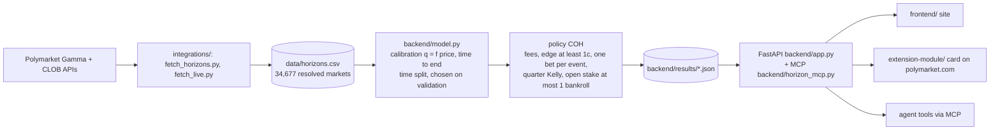

# Horizon

**When is a prediction-market price wrong enough to bet on?** Horizon reads a Polymarket price together with the time left until the market resolves, corrects the price with a calibration model fitted on 34,677 resolved markets, and says *buy YES*, *buy NO* or *wait* only when the edge survives the spread and Polymarket's taker fee.

Built at OxHack '26, Oxford, 24–25 October 2026.

- **Site:** https://web-production-c7376.up.railway.app (live decisions, backtest, *How we chose*, sealed predictions)
- **API:** https://oxhack26-production.up.railway.app (`/api/live`, `/api/backtest`, `/api/calibration`, `/api/methods`, `/api/capsule`, MCP at `/mcp`)

## The result in one paragraph

Prices are too extreme near resolution: 10–35¢ longshots win more often than priced, favourites less. On an out-of-time test (markets resolved after 2026-05-18, never used for fitting or choosing), the shipped policy **COH** (one bet per event, probabilities that sum to 1 across an event's outcomes, enter only within 24 h, net edge ≥ 1¢ after fees) earns **+31.3¢ per $1 staked [90% CI +22.2, +40.5]** over 1,827 trades with open stakes capped at one bankroll (max drawdown 0.22). The previous policy V3 earns +17.2¢. COH is positive in 15 of 17 months of a walk-forward, and a "prices are right" placebo on the same trades loses ~8¢ (p < 0.001). Where it fails: culture markets lose, crypto is about zero, 30 days out there is no edge. Every number is in `backend/results/` and on the site's *How we chose* page.

**One command reproduces every headline number:**

```bash
python integrations/reproduce.py   # re-runs the shipped pipeline from data/horizons.csv, diffs against backend/results/backtest.json
```

## Architecture



## How to run

```bash
# Backend + model (Python 3.11)
cd backend && python -m venv .venv && .venv/bin/pip install -r requirements-model.txt
.venv/bin/python model.py               # refit + rewrite results/*.json from data/horizons.csv
.venv/bin/uvicorn app:app --reload      # http://localhost:8000

# Frontend (Node 20)
cd frontend && npm ci && NEXT_PUBLIC_API_URL=http://localhost:8000 npm run dev

# Extension module (Horizon card + the decision rule computed in the browser)
cd extension-module/standalone && npm ci && npm run build
node extension-module/parity.mjs capsule/seal-20261024T153130Z.json   # same decisions as Python
```

Data refresh (optional, network): `python integrations/fetch_horizons.py` (resolved markets; hourly price paths cached in `data/raw/`, gitignored) and `python integrations/fetch_live.py` (open markets).

## Where results live

| What | File |
|---|---|
| Shipped backtest, headline, policy comparison | `backend/results/backtest.json` |
| Calibration by horizon and domain | `backend/results/calibration.json` |
| Fitted model registry (coefficients + bootstrap) | `backend/results/model.json` |
| *How we chose*: every variant, walk-forward, placebo, deflated Sharpe | `integrations/methods/summary.json` (`backend/results/methods.json` on the server) |
| Model playoff (10 candidates on validation, test opened once) | `integrations/ensemble/` |
| Robustness, capacity, cost sensitivity | `integrations/robustness/`, `integrations/model_eval/` |
| Sealed predictions (time capsule) and their opening | `capsule/`, `backend/capsule.py`, `backend/results/capsule_open.json` |

**Time capsule.** Before the outcomes existed we sealed Horizon's probabilities for every eligible open market, posted each seal's SHA-256 publicly, and pre-registered how they would be scored (`capsule/EXPECTATIONS.md`). Opening: `python backend/capsule.py open --all` (Brier model vs market with a paired event-bootstrap interval, each pre-registered expectation's verdict, and the sealed bets' result after fees).

## Method, honestly

- Split by time, never at random; all legs of one event stay on one side; test trades must open on or after the cutoff.
- Model, policy and every knob chosen on validation (the last 20% of training); the test set was opened once per comparison, and the number of variants compared is reported.
- Costs on every trade: max(half the quoted spread, 1¢) + Polymarket's taker fee for that market.
- Limits: historical spreads are not available (current spreads used); fills assumed at the last trade print ≤ 1 h before entry; drawdown measured on resolved P&L.

## Credits

Team: Gleb ([@glebbabichevv](https://github.com/glebbabichevv)), Ayaz ([@ayaz-oss](https://github.com/ayaz-oss)), Mark ([@TheMarkz3](https://github.com/TheMarkz3)).

The browser layer the extension card mounts into is pre-hackathon code by Gleb; everything under `extension-module/` was written at OxHack.

References: time-to-resolution miscalibration in prediction markets (arXiv 2602.19520); an independent replication on Polymarket (github.com/hrishi-tailor/prediction-market-calibration); Shin (1993) for de-vigging; Kull, Silva Filho & Flach (2017), beta calibration; Ranjan & Gneiting (2010), combining probability forecasts; Bailey & López de Prado (2014), the deflated Sharpe ratio.

Tooling: skills in `.claude/skills/` come from anthropics/skills, pbakaus/impeccable, nextlevelbuilder/ui-ux-pro-max-skill, Leonxlnx/taste-skill, nutlope/hallmark and emilkowalski/skill, and the style library from rohitg00/awesome-claude-design (each keeps its own licence; see `docs/SKILLS.md`). Workflow commands from [gstack](https://github.com/garrytan/gstack) (MIT).

## Team setup

```bash
git clone <this repo> && cd oxhack26
bash scripts/setup.sh      # installs gstack, creates .env.local
```
